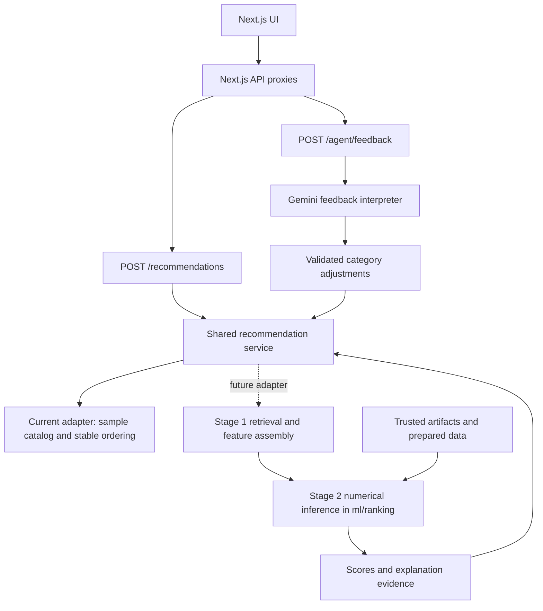
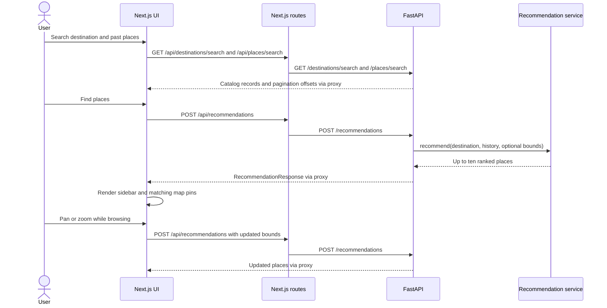
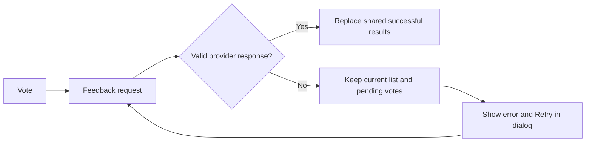

# Backend recommendations and agent integration

The website gets ranked places from FastAPI. The feedback agent sits above that same recommendation service: it interprets likes and dislikes with Gemini, then asks the service for an updated list. The initial implementation uses the existing sample catalog. Connecting the trained recommender is a separate serving integration.

The workflow produces a list of places. The **Build itinerary** dialog does not collect dates, durations, free-text constraints, or routes. It does not calculate distances or generate a day-by-day schedule.

## Current code and intended boundaries

| Responsibility | Existing code | Backend integration |
| --- | --- | --- |
| HTTP request parsing and responses | `backend/routes/recommendations.py`, `backend/schemas/recommendations.py` | Keep routes thin; delegate candidate selection and formatting to `backend/services/recommendations.py`. |
| Sample places and destination lookup | `backend/catalog.py` | Continue using fixtures until production catalog serving is ready. |
| Stage 1 retrieval | `ml/retrieval/` | A future serving adapter retrieves destination candidates for the supplied visit history. |
| User and locality features | `ml/features/`, `ml/ranking/features.py` | A future serving adapter assembles the request's features using the same transformations as training. |
| Stage 2 trained ranking | `ml/ranking/inference.py` | Call reusable model inference through an adapter, not a shell subprocess or notebook. |
| Saved models | `backend/artifacts/` | Load trusted model artifacts once at service startup when real serving is enabled. |
| SHAP explanations | Modeling/notebook work | Compute real per-candidate contributions in the ML serving adapter; never substitute fixture explanations for SHAP. |
| Feedback interpretation | New `backend/services/agent.py` | Call Gemini with validated votes and trusted category metadata; validate its structured adjustments. |
| Feedback HTTP contract | New `backend/routes/agent.py`, `backend/schemas/agent.py` | Validate request state, delegate interpretation and ranking, return updated recommendations. |

The `ml/` package remains the home of model algorithms, feature transformations, training, and reusable numerical inference. `backend/` owns HTTP, lifecycle/configuration, adapters, and request orchestration. Do not copy model-training code into route handlers. The model itself is an artifact, not the agent or a FastAPI endpoint.



## Shared recommendation service

Expose the full eligible pool before applying the display limit. A pool of four places cannot provide a fifth replacement. Return fewer places when alternatives run out; never invent or borrow locations from another destination.

The first extraction preserves existing `/recommendations` behavior: destination and visited-ID validation, exclusion of visited places, optional viewport bounds, original catalog ordering, explanation strings, response fields, and the ten-result limit.

The service responsibilities are:

1. `get_candidates(request)`: validate identity and scope and return eligible catalog records.
2. `build_recommendations(candidates, visited_place_ids)`: attach contiguous display ranks and grounded explanations to an already ordered list.
3. `recommend(request)`: select the current source's best candidates, limit to ten, and build the existing response.

With real serving, candidate retrieval and scoring go behind this boundary. Keep filtering, ranking, and the final top-ten cutoff distinct; the agent needs candidates beyond those currently displayed.

### Where the real model connects later

`ml/ranking/inference.py` already exposes `load_ranker`, `predict_scores`, `top_ranked_candidates`, and `rank_candidates`. The last function currently expects a candidate Parquet path, prepared Gold tables, and optionally a canonical trip ID. It opens data and loads the artifact per invocation; it is not yet a ready-to-use online serving service.

The UI instead sends a destination region and selected past-place IDs. Connecting the two requires a serving adapter that:

- Maps real API place/destination IDs to the catalog's canonical POI and region IDs. The `demo-*` and `a1-*` fixture IDs are not model IDs.
- Builds a request-specific history and retrieves up to 100 candidates. Do not choose an unrelated dataset trip ID as a substitute for the visitor's history.
- Produces the exact ordered feature matrix expected by the artifact, using training-compatible missing-value handling and feature provenance.
- Loads the model and read-only serving data once, predicts finite scores, and returns candidates with their true model version.
- Hydrates coordinates, names, and categories from the catalog; exposes actual SHAP evidence when available.

The current model has no feedback-training loop. Session category adjustments initially modify base candidate ordering; they do not retrain LightGBM. On the real adapter, calibrate feedback weights against the model score scale rather than adding arbitrary fixture offsets to raw model scores. Keep the original model contributions separate from session adjustments in explanations.

Model packages, feature data, indexes, and system libraries must be included in the serving environment before enabling that adapter. Render currently installs only `backend/requirements.txt`; committing a joblib file alone does not make inference available. The stub/agent release must not load the heavy ML stack or require Gold exports.

## User flow and request mapping

| User action | Browser request to Next.js | Request to FastAPI | Gemini call |
| --- | --- | --- | --- |
| Search destination | `GET /api/destinations/search?q=...` | `GET /destinations/search?q=...` | None |
| Search previous visits | `GET /api/places/search?q=...` | `GET /places/search?q=...` | None |
| Find places | `POST /api/recommendations` | `POST /recommendations` | None |
| Pan/zoom during browsing | `POST /api/recommendations` with bounds | `POST /recommendations` | None |
| Open Build itinerary | None; show the current successful list | None | None |
| Like, dislike, clear vote, or retry feedback | `POST /api/agent/feedback` | `POST /agent/feedback` | One interpretation call when votes exist |
| Close dialog | None | None | None |

### Initial search and browsing



Existing recommendation request:

```json
{
  "tripworld_region_id": "demo-kyoto",
  "visited_place_ids": ["a1-mamas", "a1-golf"]
}
```

Optional `bounds` narrows the selected destination. It is a map viewport filter, not distance tracking.

### Dialog feedback

```mermaid
sequenceDiagram
    actor User
    participant UI as Dialog and shared UI state
    participant Proxy as Next.js /api/agent/feedback
    participant API as FastAPI /agent/feedback
    participant Service as Recommendation service
    participant Gemini
    User->>UI: Open Build itinerary
    UI->>UI: Snapshot successful recommendations and request scope
    User->>UI: Like or dislike a location
    UI->>Proxy: Current IDs, original request, accumulated votes
    Proxy->>API: Forward JSON
    API->>Service: Get and validate eligible candidate pool
    API->>Gemini: Votes and trusted location/category context
    Gemini-->>API: Structured category adjustments
    API->>API: Validate categories, finite weights, bounds
    API->>Service: Rank eligible places using session adjustments
    Service->>Service: Exclude dislikes and preserve liked positions
    Service-->>API: Grounded updated list and change summary
    API-->>UI: Response via proxy
    UI->>UI: Update dialog, sidebar, and pins together
    User->>UI: Done
    UI->>UI: Close dialog; preserve successful results
```

New request contract:

```json
{
  "tripworld_region_id": "demo-kyoto",
  "visited_place_ids": ["a1-mamas", "a1-golf"],
  "current_place_ids": ["a1-kyocera", "demo-market", "demo-garden", "a1-weekenders"],
  "feedback": [
    {"place_id": "demo-market", "vote": "like"},
    {"place_id": "a1-kyocera", "vote": "dislike"}
  ]
}
```

Send all active votes on every request. A cleared vote is omitted. Previously disliked IDs may no longer be in `current_place_ids`; validate them against the eligible pool for the same scope. Reject duplicate votes, duplicate current IDs, wrong destinations, visited places, and out-of-scope IDs. No client-provided metadata or model score is trusted.

Return the existing `results` and `model_version`, plus `added_place_ids`, `removed_place_ids`, and `update_summary`. The frontend uses those IDs for New badges. `model_version` identifies the candidate/ranking source, not the Gemini model.

For fixture ranking, recompute a stable base ordering on each request, apply bounded category preferences, exclude explicit dislikes, and reserve liked locations in their current positions where possible. Compact positions if the shorter list cannot retain an old index. Do not compound previous adjusted ranks on retries. Clearing the last vote restores the base ordering without invoking Gemini, because there is no feedback to interpret.

### Error and retry behavior



No deterministic replacement for Gemini is provided when interpretation fails. Missing configuration, quota exhaustion, invalid provider output, and provider timeout return useful HTTP errors. Preserve existing recommendations and allow explicit retry; disable automatic mutation retries. If a single candidate pool is exhausted after valid feedback, a shorter successful response is expected, not an invented venue or provider fallback.

The existing Next.js proxy has a ten-second timeout. Keep Gemini's total timeout below it, and distinguish provider unavailability from invalid user requests. Request validation is 422; malformed provider output is 502; unavailable configuration/provider is 503; provider timeout is 504. Do not put API keys in browser environment variables or log full histories.

## UI integration and result ownership

Use the existing app palette and root theme tokens. Add the Build itinerary button above the ranked list and a shadcn Dialog containing the place cards and feedback controls. Reuse Button and ScrollArea; add Dialog, ToggleGroup, Badge, and Alert. The dialog has a fixed header/footer and a scrollable list, accessible title/description, focus restoration, and a mobile layout that stays within the viewport.

Keep browsing query state distinct from feedback state. `useRecommendations` retains old results during failed viewport fetches; it must not overwrite an accepted agent result. Store a refinement snapshot keyed by the complete original request (including bounds), with successful results, pending votes, and the last submitted payload. Prefer it for rendering after a successful feedback response. Ignore late mutation responses whose request scope was reset.

While the dialog is open, freeze the browsing scope and do not issue viewport refreshes. Reopening it retains successful refinements. Editing the trip, searching the whole destination, or panning after closing starts a new browsing scope and clears the old refinement. Selection falls back to the first remaining place when the selected place is removed. Empty lists remain valid and must still permit reopening the dialog to clear previous votes.

## Implementation and review order

1. Architecture documentation: this map of responsibilities and request flows.
2. Shared stub service: behavior-preserving extraction and contract coverage.
3. Feedback backend: schemas, Gemini adapter, ranking adjustments, endpoint, and mocked-provider tests.
4. Dialog and frontend wiring: shadcn components, proxy, mutation state, shared result ownership, and responsive flow checks.

Real ML serving, accounts/database persistence, chat, live research, scheduling, and geographic planning remain outside this stack. Review the original Stage 3 PRD as background; the narrower feedback-only scope above governs this implementation.
