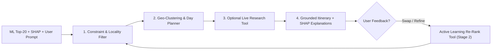

# PRD: Stage 3 AI Travel Research Agent (TripWorld)

**Project:** CMPE 256 — Cross-City Travel POI Recommender System  
**Component:** Stage 3 Grounded AI Travel Research & Itinerary Agent  
**Depends On:** Stage 1 Retrieval (`ml/retrieval/`), Stage 2 Ranking + SHAP (`ml/ranking/`), Locality Features (`ml/features/`)

---

## 1. Executive Summary & Core Value

### The Problem
- **ML Recommenders (Stage 1 + Stage 2)** excel at crunching 535K+ POIs and 444K+ multi-city trips to rank the **Top-10 mathematically best places** for a traveler, but they output a flat list of venue IDs, scores, and raw SHAP numbers. They cannot assemble a walkable day-by-day schedule, reason about geographic proximity, or adapt to natural-language constraints (*"I only have 2 days, no loud nightlife, and it's raining"*).
- **Generic LLMs (raw ChatGPT/Gemini)** write fluent itineraries, **but** they give generic tourist traps, hallucinate closed or nonexistent venues, do not know the traveler's cross-city *opportunity-normalized* taste profile, and cannot quantify *why* a place matches.

### The Value of the Stage 3 Agent
The Stage 3 AI Agent acts as a **grounded, ML-backed travel concierge**:
1. **Zero-Hallucination Personalization:** Only builds plans from POIs verified and ranked by the Stage 1 (Embeddings / Two-Tower) + Stage 2 (LightGBM / CatBoost) pipeline—never inventing fake or permanently closed venues (`fsq_date_closed` is already filtered out in `data/gold/pois_clean.parquet`).
2. **Human-Readable Explainability (SHAP → English):** Translates mathematical SHAP feature drivers (`opportunity_lift`, `tourist_ratio`, `sem_sim_max`) into transparent, trustworthy *"Why we picked this for you"* explanations.
3. **Locality-Aware Logistics & Constraints:** Converts a flat ranked list into a geographically sensible itinerary using `lat`/`lon` clustering, pacing, seasonality, and natural-language user constraints.
4. **Conversational Active Learning:** Converts user critiques (*"Too touristy"*, *"Swap #2 for outdoor food"*) into structured preference adjustments that re-rank Stage 2 candidates in real time.

---

## 2. Inputs (What the Agent Takes In)

The agent receives a **single structured payload** from the backend (assembled by Stage 1 + Stage 2 + SHAP), plus optional user chat messages:

| Input Block | Fields | Source |
| :--- | :--- | :--- |
| **1. User Trip Request** | `target_city`, `trip_days` (e.g., 3), `travel_month` / `season`, `free_text_constraints` (e.g., *"walkable, budget-friendly, prefer hidden gems"*), `conversation_history` | Frontend UI / User |
| **2. Multi-City User Taste Summary** | List of prior cities & visited POIs, top `opportunity_lift` categories (what the traveler seeks out *when available*), `preferred_tourist_ratio` (hidden gem vs. iconic landmark preference) | Person 1 (`ml/features/`) |
| **3. ML-Ranked Candidate Pool (Top 15–20)** | For each candidate POI: `poi_id`, `name`, `venue_schema`, `lat`, `lon`, `google_rating`, `google_num_reviews`, `rank_score`, `tourist_ratio`, `city_supply_share` | Person 2 + Person 3 (`ml/retrieval/`, `ml/ranking/`) |
| **4. Per-POI SHAP Explanations** | Top 3 positive & negative SHAP feature contributions per POI (e.g., `opportunity_lift: +0.62`, `sem_sim_max: +0.41`, `tourist_ratio: -0.18`) | Person 3 (`TreeExplainer`) |
| **5. Live Session Feedback (Optional)** | Accepted / rejected `poi_id`s and natural-language reactions (*"Skip #3, I hate crowded plazas"*) | Active Learning Loop |

> **Design Note:** Passing the **Top 15–20** ML candidates (rather than strictly Top 10) gives the agent a small grounded buffer to swap in candidates #11–#15 if a top venue conflicts with a user constraint (e.g., an outdoor park on a rainy day or an outlier location across town).

---

## 3. What the Agent Does (Workflow & Tools)

Instead of a single unconstrained LLM prompt, the agent executes a **4-step grounded loop** backed by deterministic tools:



### Core Tools & Responsibilities
1. **Constraint & Locality Reasoning:**
   - Interprets natural-language preferences (*"no museums after 5pm"*, *"warm beach vibe"*, *"avoid tourist traps"*) against the Top-20 ML candidates' structured metadata (`venue_schema`, `tourist_ratio`, ratings).
   - Surfaces locality awareness explicitly: explains *why* a cold-weather or warm-weather activity was selected given what the destination city actually offers relative to the traveler's multi-city history.
2. **Spatial Itinerary Assembly (`cluster_by_distance` tool):**
   - Uses each POI's `lat`/`lon` coordinates to group Morning / Afternoon / Evening stops by neighborhood so consecutive stops are physically walkable/feasible rather than zig-zagging across the city.
3. **SHAP Explanation Synthesizer:**
   - Maps top SHAP features into 1–2 concise sentences per recommended stop:
     - *Raw SHAP:* `opportunity_lift (+0.58), sem_sim_max (+0.39), tourist_ratio (-0.12)`
     - *Agent output:* *"Picked because you consistently seek out specialty art galleries in cities that offer them (like London & Kyoto), and it fits your preference for quieter local favorites over crowded landmarks."*
4. **Optional Live Verification Tool (Phase 2 Stretch):**
   - Calls a lightweight web search / weather lookup tool on the **selected** 6–10 POIs only (never the full catalog) to attach timely logistics (e.g., *"Closed on Mondays"*, *"Timed tickets recommended"*, *"Rain expected Tuesday afternoon → moved outdoor park to Wednesday"*).
5. **Active Learning Re-Ranking Tool (`rerank_with_feedback`):**
   - When the user says *"I don't like #2, give me something more outdoorsy"*, the agent extracts structured feedback (`reject_poi`, `boost_schema`, `tourist_ratio_shift`), invokes Stage 2 to re-score the Top-100 pool, and regenerates only the affected slot/day.

---

## 4. Outputs (Structured Response Contract)

The agent returns **strict Pydantic-validated JSON** so the Next.js frontend can render interactive cards, maps, SHAP badges, and thumbs-up/down feedback buttons:

```json
{
  "destination": "Madrid",
  "trip_summary": "A 2-day local-favorite art & culinary itinerary tailored to your London and Tokyo museum + neighborhood café history.",
  "locality_note": "Because Madrid has a high supply of historic art galleries and tapas plazas (unlike your winter mountain trips), recommendations emphasize culture and walkable neighborhoods.",
  "days": [
    {
      "day": 1,
      "theme": "Art Triangle & Retiro",
      "stops": [
        {
          "slot": "Morning",
          "poi_id": "foursquare:4adcda09f964a520...",
          "name": "Museo Nacional Thyssen-Bornemisza",
          "category": "ArtMuseum",
          "ml_rank": 1,
          "why_for_you": "Matches your high opportunity lift for art museums (+0.58 SHAP) and closely aligns with your London Tate Modern visit.",
          "top_shap_drivers": [
            {"feature": "opportunity_lift", "impact": 0.58},
            {"feature": "sem_sim_max", "impact": 0.39}
          ],
          "practical_tip": "10 min walk to your afternoon stop."
        }
      ]
    }
  ],
  "suggested_followups": [
    "Swap out a museum for a local market",
    "Make Day 2 less touristy",
    "Adjust for a rainy afternoon"
  ]
}
```

---

## 5. Non-Goals & Guardrails

- **Hard Grounding Rule:** Every `poi_id` in the agent's output **must** exist in the Stage 2 candidate list passed into the request. Any hallucinated venue ID is rejected by Pydantic validation and retried/dropped.
- **No Unfounded Claims:** When the live web-search tool is disabled (MVP mode), the agent must *not* fabricate exact opening hours or ticket prices—it cites only verified TripWorld attributes (`google_rating`, `google_num_reviews`, `venue_schema`, `lat`/`lon`, and SHAP drivers).
- **Latency Budget:** Target `< 4 seconds` for grounded itinerary generation (using a fast model such as Gemini 2.5 Flash or GPT-4o-mini with native structured JSON output).
- **Provider Agnostic & Deterministic Fallback:** Supports any OpenAI-compatible or Gemini API key via environment variables, plus a deterministic **template fallback** (prototyped in `notebooks/03_stage2_ranking_automl_shap.ipynb`) so the demo never fails if an API key is unavailable or rate-limited.

---

## 6. Evaluation & Success Metrics

1. **100% Grounding Rate:** 0% hallucinated or closed POIs across test prompts (verified programmatically against `data/gold/pois_clean.parquet`).
2. **SHAP Faithfulness:** Every generated *"Why for you"* explanation references at least one of the top-3 actual SHAP drivers for that POI.
3. **Geographic Coherence:** Average straight-line distance between consecutive stops in a day is lower than the raw unclustered Stage 2 Top-10 ranking order.
4. **Feedback Lift (Active Learning):** Simulated 1-step user feedback measurably improves `NDCG@10` on remaining slots (tracked in `notebooks/03_stage2_ranking_automl_shap.ipynb`).

---

## 7. Phased Rollout Plan

| Phase | Scope | Deliverable |
| :--- | :--- | :--- |
| **Phase 1 (Current — Model Track)** | Grounded prompt + SHAP context builder + deterministic fallback | `notebooks/03_stage2_ranking_automl_shap.ipynb` |
| **Phase 2 (Backend Integration)** | FastAPI `/agent/plan` & `/agent/feedback` endpoints + Pydantic grounding validator + `cluster_by_distance` tool | `backend/agent.py`, `backend/main.py` |
| **Phase 3 (Frontend + Live Tools)** | Interactive itinerary UI with SHAP explanation pills, thumbs-up/down Active Learning loop, and optional live weather/hours search | `frontend/app/` |
